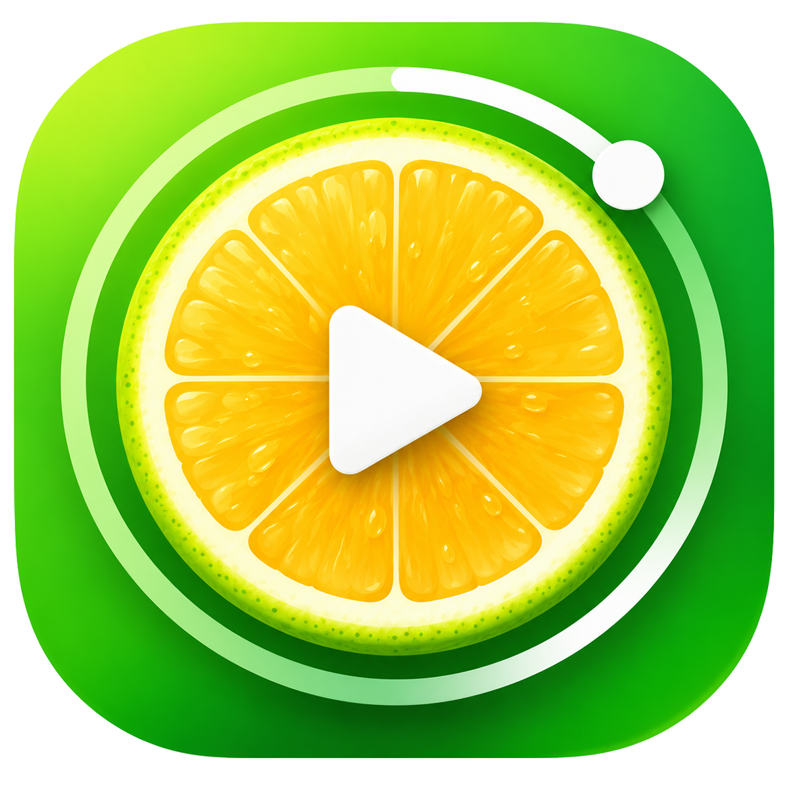
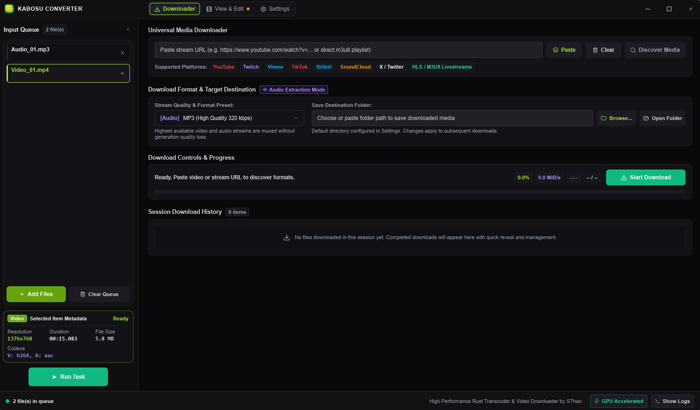
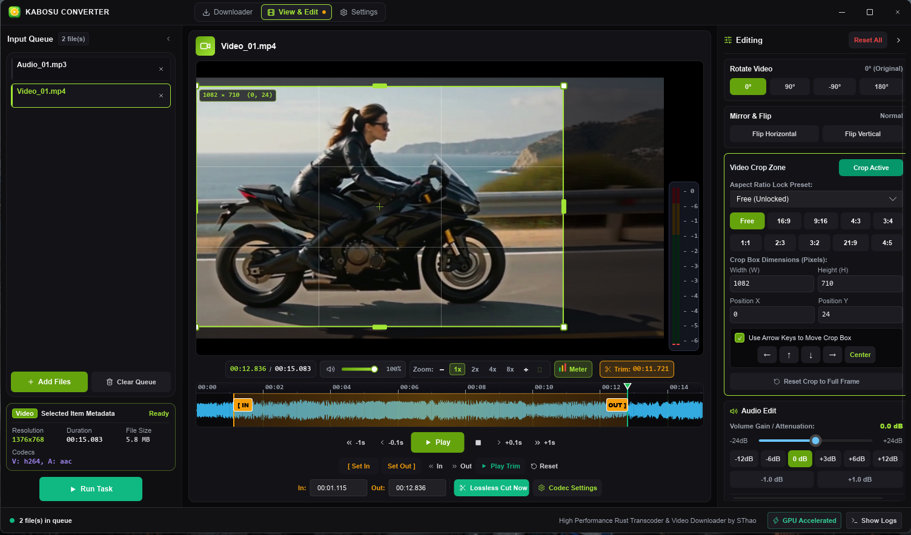
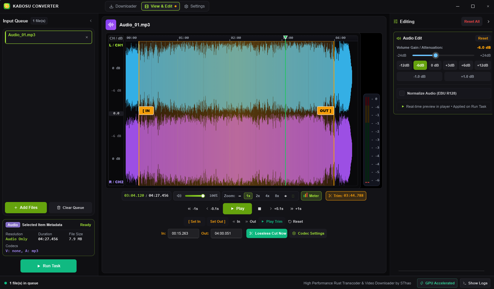

# Kabosu Converter

<p align="center">
  
</p>

<p align="center">
  <strong>High-performance, modern video & audio transcoding studio and universal stream downloader.</strong><br>
  Built from scratch in <strong>Rust</strong> and <strong>Slint</strong>, powered by local <strong>FFmpeg 8+</strong> and <strong>yt-dlp</strong> binaries.
</p>

<p align="center">
  <a href="LICENSE"></a>
  <a href="https://github.com/grimztha/KabosuConverter/actions"></a>
  <a href="https://github.com/grimztha/KabosuConverter/releases"></a>
  <a href="https://slint.dev"></a>
  <a href="https://www.rust-lang.org"></a>
</p>

---

## Screenshot Preview

<p align="center">
  
</p>

<p align="center">
  
</p>

<p align="center">
  
</p>

---

## About

**Kabosu Converter** is a lightweight, desktop media encoder and universal web video downloader. Designed as a modern, high-performance alternative to bloated, electron-based, or JVM-dependent transcoders, it enables rapid video and audio conversion, instant lossless trimming, aspect-ratio cropping, loudness normalization, and direct media downloading from major platforms.

Built with **Rust** for native performance and memory safety, **Slint** for a fluid, hardware-accelerated declarative UI, and backed by the asynchronous **Tokio** runtime, Kabosu Converter harnesses local **FFmpeg 8+** and **yt-dlp** binaries to deliver zero-lag processing and instant operations.

---

## Install

### Download & Run (Prebuilt)

1. Download the latest release for your platform from [**Releases**](https://github.com/grimztha/KabosuConverter/releases):
   - **Windows**: `kabosu-converter-v*-x86_64-pc-windows-msvc.zip`
   - **macOS**: `kabosu-converter-v*-apple-darwin.tar.gz` (Apple Silicon or Intel)
   - **Linux**: `kabosu-converter-v*-x86_64-unknown-linux-gnu.tar.gz`
2. Extract the archive and launch `kabosu-converter` (or `kabosu-converter.exe` on Windows).
3. **Zero-Config Setup**: Required external media tools (`FFmpeg`, `yt-dlp`) are automatically provisioned and verified into your local user data folder on first run if not already present on your machine.

---

## Highlights & Key Features

- **🎬 Media Player & Frame-Accurate Trimming**: Real-time visual scrubbing, audio equalizer visualizer, glowing range markers (`In` / `Out`), precision frame stepping, and instant lossless cut export without re-encoding.
- **📐 Interactive Crop & Video Geometry**: Live on-canvas draggable crop box with 8 handles, aspect ratio lock presets (`16:9`, `9:16`, `4:3`, `1:1`, etc.), keyboard arrow nudge, 90°/180° rotation, and mirroring.
- **🔊 Studio Audio Editing & Normalization**: Volume gain/attenuation (`-24 dB` to `+24 dB`), broadcast-standard EBU R128 loudness normalization, and live dual-channel VU dynamic peak meters.
- **⚡ High-Performance Transcoding**: Hardware-accelerated encoding (NVENC, QSV, AMF) for H.264, H.265 (Apple `hvc1`), AV1 (10-bit), VP9, ProRes (Proxy to 4444 XQ), and Avid DNxHR/DNxHD.
- **🔄 Lossless Container Remuxing**: Swap containers (`.mp4`, `.mkv`, `.mov`, `.webm`, `.avi`, `.ts`), isolate video/audio streams, or swap audio tracks in milliseconds with zero quality loss.
- **🌐 Universal Media Downloader**: Paste stream links from YouTube, Twitch, Vimeo, TikTok, Bilibili, SoundCloud, Twitter/X, or direct HLS playlists to inspect available formats and download video or audio with one click.
- **📦 Self-Contained Binary Management**: Automatic background discovery, streaming download, and SHA-256 verification of FFmpeg and yt-dlp into your clean user app data directory.

---

## Tech Stack

| Component                    | Technology                                       | Description                                                                              |
| :--------------------------- | :----------------------------------------------- | :--------------------------------------------------------------------------------------- |
| **Core Language**      | [Rust](https://www.rust-lang.org/) (2021 Edition) | Memory-safe, concurrency-driven, zero-overhead systems language                          |
| **GUI Framework**      | [Slint](https://slint.dev/) (v1.18+)              | Native declarative GUI compiled directly to native code with GPU rendering               |
| **Async Runtime**      | [Tokio](https://tokio.rs/) (v1.46+)               | Multi-threaded async engine powering non-blocking I/O, process management, and streaming |
| **Media Processing**   | [FFmpeg](https://ffmpeg.org/) (8+)                | High-performance encoding, decoding, filtering, and stream extraction engine             |
| **Media Inspection**   | [FFprobe](https://ffmpeg.org/ffprobe.html)        | JSON-based deep container and stream metadata introspection                              |
| **Media Preview**      | [FFplay](https://ffmpeg.org/ffplay.html)          | Synchronized hardware-accelerated playback and audio preview                             |
| **Stream Downloader**  | [yt-dlp](https://github.com/yt-dlp/yt-dlp)        | Industry-standard web video extraction and format discovery tool                         |
| **Native Windows API** | `windows-sys` (v0.61)                          | Native shell integration, IDropTarget OLE drag-and-drop, and window styling              |
| **Binary Compression** | `zip`, `tar`, `xz2`                        | Multi-format archive extraction for automated binary provisioning                        |
| **CI/CD Automation**   | GitHub Actions                                   | Automated multi-platform testing and tagged release binary packaging                     |

---


## Building from Source

### Prerequisites

- **Rust** (1.80+ or latest stable): [Install Rust](https://rustup.rs/)
- **C/C++ Build Tools**:
  - Windows: Visual Studio C++ Build Tools or MSVC toolchain
  - Linux: `libfontconfig1-dev`, `libfreetype6-dev`, `libx11-dev`, `libxkbcommon-dev`, `libasound2-dev`
  - macOS: Xcode Command Line Tools (`xcode-select --install`)

### Development Build

```bash
# Clone the repository
git clone https://github.com/grimztha/KabosuConverter.git
cd KabosuConverter

# Run in debug mode
cargo run
```

### Running Tests

```bash
cargo test
```

### Optimized Production Release Build

```bash
cargo build --release
```

The optimized standalone binary will be generated at:

- **Windows**: `target/release/kabosu-converter.exe`
- **macOS / Linux**: `target/release/kabosu-converter`

---

## License

This project is open-source software licensed under the **[GNU General Public License v3.0](LICENSE)**.
